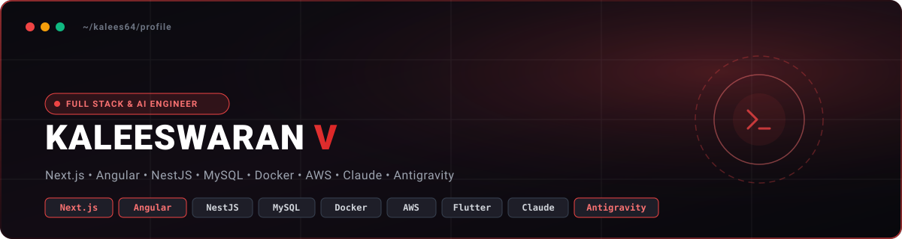
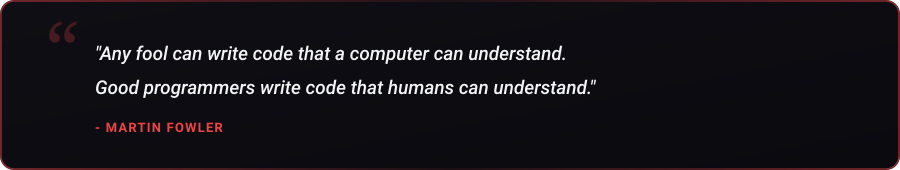
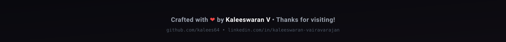

  

  

   &nbsp;
   &nbsp;
   &nbsp;
  

  

<h2 align="center">👨‍💻 About Me</h2>

  

  

  Hey! I'm <b>Kaleeswaran V</b>, a passionate <b>Full Stack Engineer, AI-Assisted Developer & Mobile App Developer</b> based in India. 
  I bring 2+ years of experience designing and architecting scalable web and mobile applications, specializing heavily in <b>Next.js</b> and <b>Angular</b>, alongside <b>NestJS</b>, <b>MySQL</b>, <b>Docker</b>, and <b>AWS</b>. I also possess 1+ years of hands-on AI/LLM integration experience (Claude API, OpenAI API, Gemini API), prompt engineering, agent-based coding, and Flutter cross-platform development.

   &nbsp;
   &nbsp;
  

  <b>Core Expertise:</b> Next.js, Angular, NestJS, MySQL, Docker, AWS & Flutter. 
  <b>Philosophy:</b> <i>"Turning complex ideas into scalable, production-ready enterprise solutions!"</i>

<table width="100%" border="0" align="center">
  <tr>
    <td width="50%" align="center" style="padding: 14px;">
      <h4>🎯 Flagship Project</h4>
      
<b>Pharmacy4U</b> Next.js, NestJS, MySQL, Docker & AWS Healthcare Platform

    </td>
    <td width="50%" align="center" style="padding: 14px;">
      <h4>⚡ Active Deep Dives</h4>
      
<b>Next.js & Angular Ecosystems</b> Microservices Architecture & AI-Assisted Workflows

    </td>
  </tr>
  <tr>
    <td width="50%" align="center" style="padding: 14px;">
      <h4>💼 Current Role</h4>
      
<b>Full Stack Developer</b> Assay Clinical Research Pvt Ltd

    </td>
    <td width="50%" align="center" style="padding: 14px;">
      <h4>🤝 Collaboration</h4>
      
<b>Healthcare, Web & AI Solutions</b> Open to exciting enterprise and product opportunities

    </td>
  </tr>
</table>

<h2 align="center">🚀 Featured Project Spotlight</h2>

<table width="100%" border="0" align="center">
  <tr>
    <td align="center" style="padding: 22px;">
      <h3>🏥 Pharmacy4U</h3>
      
<i>A production-grade healthcare and smart pharmacy platform supporting medicine ordering, prescription upload, real-time order tracking, and intelligent AI-driven clinical workflow automation.</i>

       
      

         &nbsp;
         &nbsp;
         &nbsp;
         &nbsp;
        
      

       
      

        
      

    </td>
  </tr>
</table>

<h2 align="center">🛠️ Tech Stack & Skills</h2>

<b>Priority Frontend Frameworks & Web Development</b>

   &nbsp;
  

  

<b>Core Programming Languages</b>

  

<b>Backend, Cloud & Databases</b>

  

<b>AI, Testing & DevOps</b>

  

   &nbsp;
   &nbsp;
   &nbsp;
   &nbsp;
   &nbsp;
   &nbsp;
  

<h2 align="center">📊 GitHub Analytics & Activity</h2>

   &nbsp;&nbsp;
  

  

  

<h2 align="center">⚡ Contribution Journey</h2>

  

<h2 align="center">📬 Let's Connect & Collaborate</h2>

<i>Whether you want to discuss system architecture, explore open-source collaboration, or just say hello — my inbox is always open!</i>

<table border="0" align="center">
  <tr>
    <td align="center" width="220" style="padding: 16px;">
      <a href="https://www.linkedin.com/in/kaleeswaran-vairavarajan" target="_blank">
          
        
      </a> 
      <b>Professional Network</b>
    </td>
    <td align="center" width="220" style="padding: 16px;">
      <a href="mailto:vkalees64@gmail.com">
          
        
      </a> 
      <b>Direct Collaboration</b>
    </td>
    <td align="center" width="220" style="padding: 16px;">
      <a href="https://github.com/kalees64" target="_blank">
          
        
      </a> 
      <b>Code & Projects</b>
    </td>
  </tr>
</table>

  

